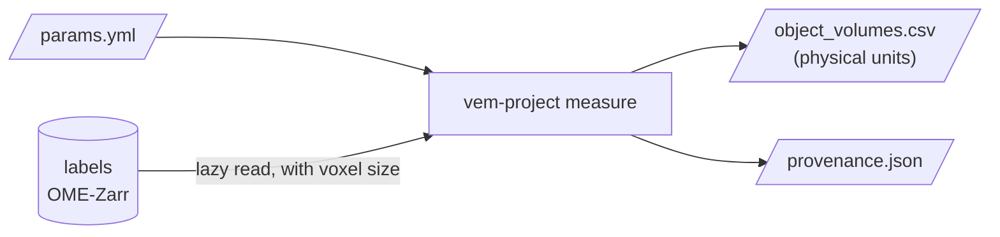

# Usage



## Command line

Write a parameter file. Paths are relative to the file:

```yaml
labels: ../data/my_labels.ome.zarr  # integer label image, OME-Zarr
level: 0                            # pyramid level; 0 = full resolution
output_dir: ../results/my_run
```

Then run:

```bash
vem-project measure params.yml
```

Keeping the parameters in a file means a run can be repeated exactly, and
works the same on a laptop and in an HPC batch job.

## Python

```python
from vem_project.io import read_ome_zarr
from vem_project.measure import object_volumes

labels = read_ome_zarr("data/my_labels.ome.zarr")  # lazy: nothing loaded yet
print(labels.voxel_size, labels.unit)
volumes = object_volumes(labels)  # processed chunk by chunk
```

## Container

```bash
docker build -t vem-project .
docker run --rm --user "$(id -u):$(id -g)" \
    -v /path/to/project:/data \
    vem-project measure /data/params.yml
```

`-v` makes your project folder visible inside the container at `/data`;
`--user` makes the output files belong to you.

On an HPC cluster with Apptainer, once an image is published:

```bash
apptainer pull vem-project.sif docker://ghcr.io/ccp-volume-em/vem-project:v0.1.0
apptainer run --bind /path/to/project:/data vem-project.sif measure /data/params.yml
```
